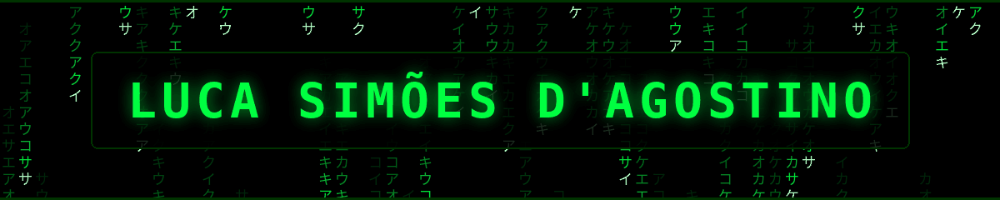

**Estudante de Desenvolvimento de Software Multiplataforma, com foco em dados/BI e interesse em back-end.**

EN: Software development student focused on data/BI, interested in back-end. Open to internships.

  

| Sistema / Repositório | Descrição | Tecnologias | Acesso |
| :--- | :--- | :--- | :---: |
| 💇 **[Studio Patty Leão](https://github.com/maxgodoydev/Studio_Patty_Leao)** | ERP de um salão de beleza em uso real: agendamentos, estoque, financeiro e BI básico. Projeto em equipe. **Minha parte:** Vitrine Digital com reservas de produtos, modelos Mongoose, painel administrativo e integração de autenticação. |     |   |
| 💈 **[BarberShop Do Gui](https://github.com/maxgodoydev/BarberShop-Do-Gui)** | Sistema para uma barbearia real do bairro: agendamento online, painel da equipe e BI. Projeto em grupo. **Minha parte:** back-end em Java (agendamento, disponibilidade, reservas, acesso do cliente e site público). |    |  <!-- TODO: botão Online com a URL do Render --> |
| 🧁 **[PM Bem-Casados](https://github.com/Luck16Ash/PM-Bem-Casados)** | Em andamento, em squad de 5 pessoas. Plataforma para uma confeiteira do bairro divulgar os bem-casados e alcançar mais clientes. |   |  |
| 🎓 **[InteliBolsas](https://github.com/Luck16Ash/InteliBolsas)** | Sistema acadêmico para gestão e divulgação de bolsas de estudo, com cadastro, filtros e organização dos dados. |   |  |

  

  

