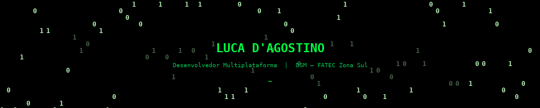
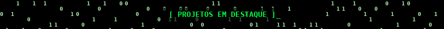
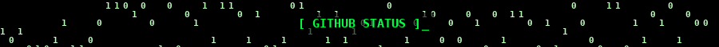
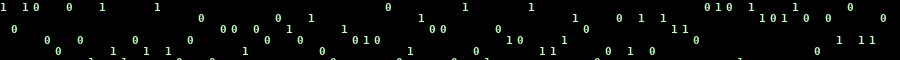
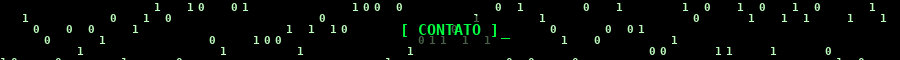

 

<!-- PROJETOS EM DESTAQUE -->

  

<table>
  <tr>
    <td width="50%" valign="top">
      <h3 align="center">🎓 InteliBolsas</h3>
      

        
      

      
<strong>Sistema acadêmico de gestão e divulgação de bolsas de estudo.</strong>

      

        <strong>🎯 Problema:</strong> Informações de bolsas dispersas, sem estrutura de acesso por perfil. 
        <strong>✅ Solução:</strong> CRUD com separação de perfis (admin, estudante, instituição), filtros e banco relacional. 
        <strong>💡 Impacto:</strong> Centralização e consulta estruturada de oportunidades.
      

      

        
        
        
        
        
      

      

      

        <strong>Soft-skills evidenciadas:</strong> 
        Modelagem de dados · Separação de responsabilidades · Raciocínio de perfis de acesso
      

    </td>
    <td width="50%" valign="top">
      <h3 align="center">💇 Studio Patty Leão</h3>
      

        
      

      

        
      

      
<strong>ERP web para salão de beleza — sistema em produção.</strong>

      

        <strong>🎯 Problema:</strong> Controles fragmentados em cadernos, planilhas e mensagens avulsas. 
        <strong>✅ Solução:</strong> Plataforma unificada com agendamentos, agenda profissional, estoque, financeiro e BI básico. 
        <strong>💡 Impacto:</strong> Visão centralizada da operação do salão, com suporte real à gestão.
      

      

        
        
        
        
        
      

      

      

        <strong>Soft-skills evidenciadas:</strong> 
        Visão de produto · Empatia com usuário real · Entrega em ambiente de produção
      

      

        
        
      

    </td>
  </tr>
</table>

<!-- GITHUB STATUS -->

  

  

<!-- BEGIN ACTIVITY-GRAPH -->
<picture>
  <source media="(max-width: 767px)" srcset="activity-graph-mobile.svg">
  
</picture>
<!-- END ACTIVITY-GRAPH -->

---

<!-- CONTATO -->

  

<!-- CONTADOR DE VISUALIZAÇÕES -->

  

